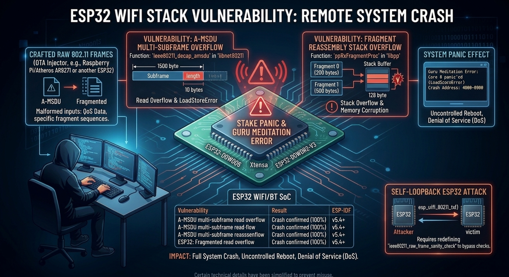

# ESP32-WiFi-Firmware-ESP-IDF-v5.4
ESP32 WiFi Firmware v7.45.265 - Vulnerabilities

# What's Inside the ESP32 WiFi Stack

The ESP32 is one of the most successful microcontroller designs of the last decade. It's cheap, it has WiFi and Bluetooth built in, and the developer ecosystem around it is enormous. I've used it in projects, seen it in products, and watched it become the default choice for anyone building networked embedded hardware.

What bothered me, eventually, was a question I couldn't answer: what does the WiFi stack actually do when it receives a malformed frame?

The networking code on the ESP32, everything from 802.11 frame parsing to Bluetooth baseband management, ships as precompiled static libraries. Espressif distributes them as `.a` archive files alongside the ESP-IDF SDK. You link them in and your firmware works. You cannot read their source, you cannot modify them, and if there's a bug in them, you can't patch it yourself. This arrangement is common in the wireless chip industry, for a mix of regulatory and intellectual-property reasons, but it creates a situation where security-critical code runs in hundreds of millions of devices with essentially no independent review.

## Opening the Blobs

The starting point was straightforward: `esptool` to dump the full 8 MB flash image from a live ESP32, and ESP-IDF's SDK to pull the library archives cleanly. I had two chips to work with, an ESP32-D0WDQ6 rev 1.0 running MicroPython v1.29.0 (which ships with ESP-IDF v5.5.2 and a WiFi blob around 1.78 MB), and an ESP32-D0WDR2-V3 rev 3.1 running an Arduino-based firmware built against ESP-IDF ~v5.3 (blob around 1.57 MB). The version difference turned out to matter a great deal.

Modern disassembly tooling supports the Xtensa LX6 architecture well, and the blobs had enough embedded symbol information to give meaningful names to a large fraction of functions. 

Static disassembly alone produces too much noise. To find the interesting paths, I ran a register-level static taint analysis pass across the full call graph (it's a personal anlyzer stand alone based on the analysis of another ida's plugin). The idea is to label every byte entering the chip from the radio as attacker-controlled, then follow those bytes forward through every operation they touch. After configuring 30+ WiFi and BLE entry-point functions as taint sources and running the analysis across 94 object files and 11 libraries, I had about 7,500 candidate findings: 916 WRITE_ADDR sinks, 1,800 INDIRECT_TARGET sinks, 4,800 READ_ADDR sinks.

Then came the unglamorous part: going through them. Most were immediately dismissible, bounds checks in the disassembly I'd missed on first pass, allocation sizes that matched copy sizes exactly, write addresses that traced back to global pointers set at initialization rather than anything from the frame. For anything that survived triage, I'd write a crafted 802.11 frame and send it to the ESP32 using a Raspberry Pi with an Atheros AR9271 adapter in monitor mode. That adapter can inject raw MAC-layer frames that normal WiFi stacks would never generate, it doesn't care about sequence numbers, encryption state, or whether the payload makes any sense. The ESP32 was running as an open SoftAP throughout, with its serial output connected so I'd see any panic messages.

## The First Real Crash

The finding that held up was in a function called `ieee80211_decap_amsdu` inside `libnet80211/ieee80211_ht.o`. A-MSDU "Aggregate MAC Service Data Unit" is an 802.11n mechanism for packing multiple small payloads into a single QoS Data frame, which improves throughput by reducing per-frame overhead. The function iterates over the packed sub-payloads, reads the declared length of each one from a two-byte big-endian field in the sub-frame header, allocates an output buffer of that size from the heap, then calls `ets_memcpy` (a copy routine in the ROM) to fill it.

The function doesn't check whether the declared length is consistent with the number of bytes actually remaining in the received frame.

If you send a frame that declares a sub-payload length of 1500 bytes but only contains 10 bytes of actual data after the header, the chip allocates a 1500-byte buffer and starts copying. It copies the 10 real bytes, then keeps going, through whatever happens to be adjacent in heap memory, then into unmapped regions, then into the execute-only ROM area starting at 0x40000000. That region doesn't permit data reads. The Xtensa CPU throws a LoadStoreError exception, the device prints `Guru Meditation Error: Core 0 panic'ed (LoadStoreError)` to serial, and reboots. 

Concretely, the frame that triggers this is a QoS Data frame, 802.11 type 2, subtype 8, with the A-MSDU Present bit set in the QoS Control field (bit 7, so QoS Control = 0x0080). The addr1 and addr3 fields carry the target ESP32's BSSID; addr2 carries the MAC of a client already associated to that AP, which you can passively sniff before the attack. The frame must be injected with ToDS set when targeting an AP.

Inside the frame body, two A-MSDU sub-frames are chained. Each sub-frame starts with a six-byte destination MAC, a six-byte source MAC, and a two-byte big-endian length field, followed by the payload. The first sub-frame is entirely normal: length field declares 40 bytes, 42 bytes of payload follow, padded to four-byte alignment. The second sub-frame is where the trigger lives: the length field declares 1500 bytes (0x05DC in big-endian), but the actual payload contains only 10 bytes of data. The frame ends there. The chip receives a structurally valid 802.11 frame, enters the A-MSDU processing path, handles the first sub-frame cleanly, then hits the second, reads 1500 from the length field, allocates a 1500-byte buffer, and starts copying from a position in the frame that has only 10 bytes left in it.

One frame. No prior interaction needed. 100% reproducible across both silicon revisions.

There's a version dependency that makes this more interesting. The older blob, the v5.3-era one in the Arduino firmware, doesn't crash. I sent it hundreds of the same crafted frames and got nothing. The `ieee80211_decap_amsdu` function in that version doesn't reach the vulnerable code path. Something was changed in v5.4 that introduced it. Exactly what changed I can't tell from diffing binaries without source, but the behavioral difference is sharp: one version crashes instantly, the other doesn't crash at all.

A related bug in the same function triggers through a different input. The same QoS Data frame structure applies, with the same addr1/addr2/addr3 layout and A-MSDU bit set. This time, the first sub-frame declares a length of zero, with 18 bytes of padding following the header. The second sub-frame declares a length of 0xFFFE, 65,534 bytes, with 20 bytes of actual payload. The zero-length first sub-frame causes an underflow in the remaining-bytes tracking variable during the unsigned subtraction used to advance the frame cursor. The loop then reaches the second sub-frame with a corrupted remaining-length value, accepts the 65,534-byte declared size as valid, and passes it to `ets_memcpy`. The overread starts immediately and runs far past any valid memory. The crash address in the panic output is different from V-001 (0x40008b02 rather than 0x4000648a), confirming a different entry point into the execute-only ROM region, but the outcome is identical: a 100% rate crash from a single frame.

## The Fragment Bug

The second independent crash was in `ppRxFragmentProc` in `libpp/pp.o`, which handles the reassembly of fragmented 802.11 data frames. Fragmentation lets large frames be split across multiple transmissions and reassembled at the receiver. The reassembly function has a 128-byte stack buffer for accumulating fragment data.

The trigger requires two frames sent in rapid succession, within a millisecond of each other, both using the MAC of an associated client as addr2. Fragment zero is a standard non-QoS data frame (type 2, subtype 0) with the MoreFragments flag set in the Frame Control field (FCfield = 0x06, combining FromDS and MoreFragments). The Sequence Control field encodes both the sequence number and fragment number; for the first fragment, the fragment number field is zero. The frame body begins with an LLC/SNAP header (DSAP 0xAA, SSAP 0xAA, control 0x03, OUI 0x000000, EtherType 0x0800) which is required for the frame to pass the initial classifier, followed by 200 bytes of arbitrary payload.

Fragment one uses the same addr1/addr2/addr3 and the same sequence number in Sequence Control, but the fragment number field is incremented to one, and the MoreFragments flag is cleared (FCfield = 0x02, FromDS only, last fragment). Its payload is 500 bytes of arbitrary data. No LLC/SNAP header on the second fragment, only the continuation payload.

When both frames arrive, the reassembly function accumulates them: 200 bytes from the first, 500 from the second, totaling 700 bytes written into a 128-byte stack buffer. Stack overflow, guaranteed.

Finding two independent bugs in the same version of the same blob, both introduced around v5.4, suggests something worth noting about how that period of development went. It's not a disaster; the chip has been in production for years, and these bugs aren't trivially accessible to random internet traffic, but two separate unsafe memory operations in adjacent subsystems of the same release range is a pattern. The `ieee80211_decap_amsdu` change and the fragment reassembly function may have been written independently, but they share an assumption that declared lengths can be trusted.

## One ESP32 Crashing Another

Partway through testing, I wanted to try removing the Raspberry Pi from the equation. If you have one ESP32 associated with the same AP as the victim, can you crash it directly?

ESP-IDF exposes `esp_wifi_80211_tx()` for injecting raw 802.11 frames. Looks perfect. Except when I tried sending QoS Data frames through it, which is what the A-MSDU exploit requires, they never arrived at the victim. No error, no obvious rejection, just silence.

Digging into the disassembly led to `ieee80211_raw_frame_sanity_check`, an internal function called before transmission. It inspects the frame subtype field using a sign-extend-then-branch pattern: extend the subtype to a signed value, and reject it if it's ≥ 0x80. QoS Data frames have subtype values in the range 8–15, which pass that check, but there's also a direct comparison that catches subtype ≥ 8 on a separate path. The function drops the frame silently, and the caller never knows.

The fix turned out to be trivially simple. `ieee80211_raw_frame_sanity_check` is a named exported symbol. If you define a function with the same name in your own application code and compile with `-Wl,--allow-multiple-definition`, the linker resolves calls to your version instead of the library's. Your version returns zero unconditionally. QoS frames go through. Associate the attacking ESP32 to the same AP as the victim, call `esp_wifi_80211_tx()` with the crafted frame, and the victim crashes immediately.

No external hardware. One five-dollar module attacking another.

## Most of It Didn't Crash

It's worth being clear about this: 7,500 findings, and most of them were non-exploitable. The RSN IE parser has an integer overflow that gets caught by clip logic. The vendor IE callback dispatcher performs correct bounds checking at the entry point. The RSN Override mechanism triggered by a Wi-Fi Alliance OUI is present in the binary but completely dead on ESP32, it's Wi-Fi 7 code that was compiled in but never connected to the Wi-Fi 4/5 stack the chip actually runs. The tainted write addresses in the wDev receive processing function carry attacker-controlled values to fixed hardware-initialization addresses, not to anything an attacker can influence.

The blob is not a pile of exploitable bugs waiting to be found. The confirmed crashes are real and sharp, but they represent a small fraction of the analysis surface. The majority of the code handles malformed input defensively, often in ways that are non-obvious from the binary.

What that means is that this kind of audit is both more tractable and more necessary than it might seem. Tractable, because most of the work is elimination, crossing candidates off the list as you understand why they're safe. Necessary, because the cases that survive elimination are genuinely dangerous, and they wouldn't be found by any process short of this one.

## On Binary Blobs in Deployed Hardware

There's a broader question underneath all of this, one that doesn't have a satisfying answer.

Binary blobs ship in hundreds of millions of devices. The ESP32 WiFi stack is one of the more scrutinized examples, Espressif is a well-resourced company with a large developer community. Other vendors ship similar blobs with less visibility and fewer resources for internal security review. The code runs on devices that sit on home networks, in hospitals, in factories, in infrastructure. Almost none of it has been audited by anyone outside the vendor.

Espressif has been notified with all the details on 01.11.2026 but... I'm not interested in your bug bounty

Please note that certain technical details in this article may have been intentionally simplified, altered, or omitted to prevent the vulnerabilities described from being indiscriminately exploited by anyone with access to this information. The content is intended to share research findings without providing a turnkey exploitation guide

---

## Findings Summary

| Vulnerability |  Result | ESP-IDF |
|---------------------------------------|-------------------------------------|-----------|
| A-MSDU multi-subframe read overflow   | Crash confirmed (100%)              |   v5.4+   |
| A-MSDU zero-length subframe underflow | Crash confirmed (100%)              |   v5.4+   |
| Fragment reassembly stack overflow    | Crash confirmed (100%)              |   v5.4+   |
| ROM SIP buffer exhaustion             | Hang confirmed (self-loopback only) | All (ROM) |
